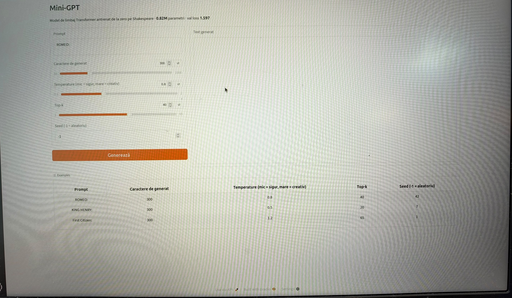
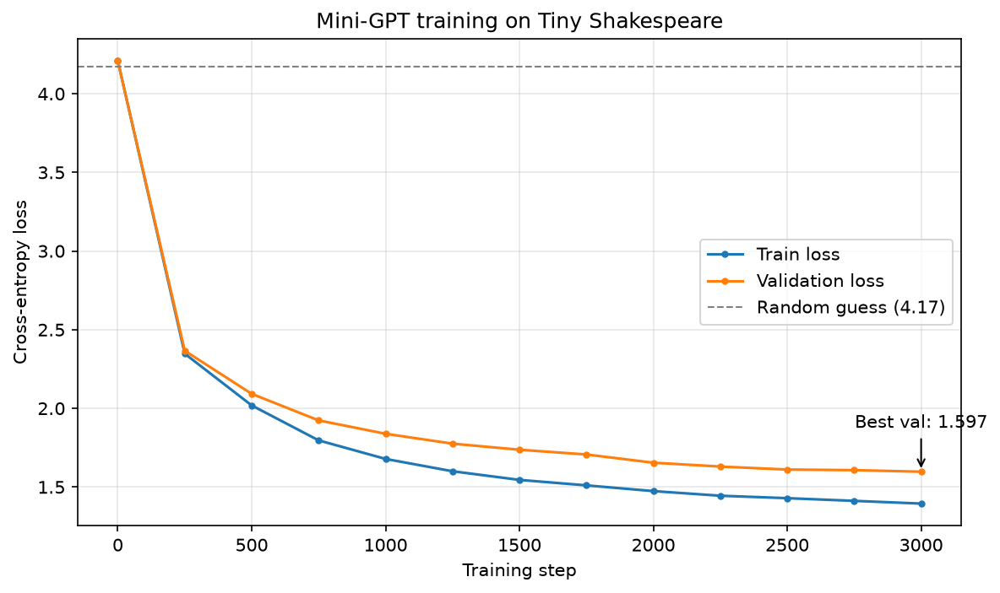
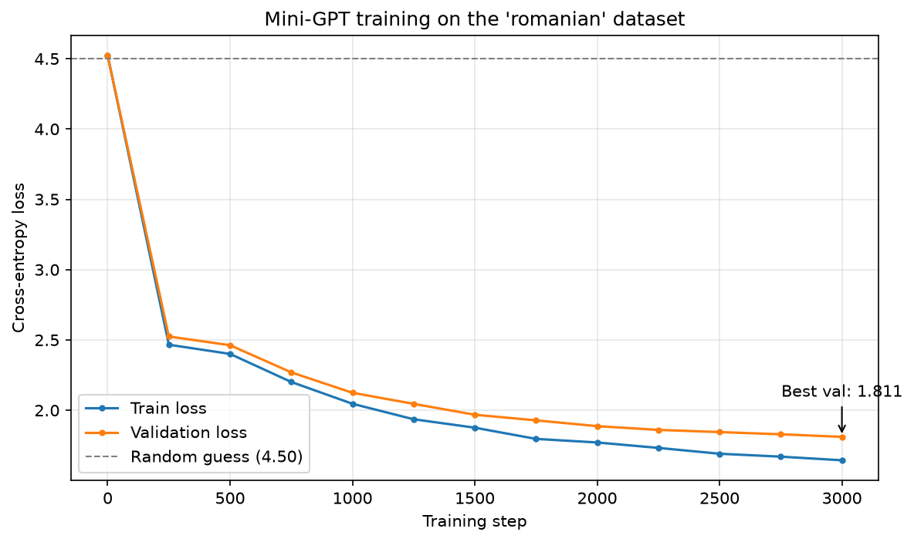

# Mini-GPT

A character-level GPT language model built from scratch in PyTorch, trained on two corpora: **Shakespeare** and **classic Romanian prose** (Caragiale, Slavici, Queen Marie).

**▶ Try it online: [gglvxx.github.io/mini-gpt](https://gglvxx.github.io/mini-gpt/)** (runs entirely in your browser, in English and Romanian)

[](https://gglvxx.github.io/mini-gpt/)


## How it works (in plain English)

**Mini-GPT is a program that taught itself to write in the style of the texts it read, one letter at a time.** Nobody explained grammar or what a play or a story looks like. It figured everything out from examples. One model learned from Shakespeare, a second one from classic Romanian writers.

**What it does.** Think of the word suggestions on your phone keyboard, but at the level of single letters, in a loop:

1. It receives the start of a text, for example `ROMEO:` or `A fost odată`
2. It guesses the most likely **next letter**
3. It adds that letter to the text and guesses again
4. Repeated a few hundred times, this produces a full passage

**How it learned.** It read hundreds of thousands of characters of text and played one game thousands of times: *"I hide the next letter, you guess it."* After every mistake, it slightly adjusted its 830,000 internal numbers (parameters). At first it guessed completely at random. By the end, instead of hesitating between all possible characters, it hesitates between only a handful on average.

**What it knows, and what it doesn't.**
- ✅ **Form:** dialogue layout, real words, punctuation, Romanian diacritics, even 19th-century spelling
- ❌ **Meaning:** the sentences don't make sense. Like a parrot that has listened to thousands of books, it imitates the sound perfectly without understanding the story.

**How it relates to ChatGPT.** It uses the same core technology, the **Transformer** architecture, and the same principle: *predict the next piece of text*. The difference is scale: this model has under one million parameters and was trained on about 1 MB of text, while large models like GPT-3 have 175 billion parameters, read a large part of the internet, and receive extra training to hold conversations.

**Try it yourself.** Open the [live demo](https://gglvxx.github.io/mini-gpt/), pick **Shakespeare** or **Română**, and press **Generate**. Keep in mind it is not a chatbot: if you ask a question, it won't answer it, it will simply continue the text.

## Features

- **Decoder-only Transformer** implemented from scratch: causal multi-head self-attention, feed-forward layers, residual connections, LayerNorm
- **Two datasets**: Tiny Shakespeare and a custom Romanian prose corpus, selected with one environment variable
- **Data-quality pipeline** for raw Project Gutenberg sources: boilerplate removal, diacritics and punctuation normalization, automatic rejection of books transcribed without diacritics, rare-symbol filtering
- **Robust data download** with retries and a local cache
- **Character-level tokenizer** with encode/decode roundtrip
- **Hardware-aware config**: automatically uses a larger model when a CUDA GPU is available
- **Training loop** with train/val evaluation, gradient clipping and best-checkpoint saving
- **Loss tracking** with automatically generated training curves
- **Streaming text generation** with temperature and top-k sampling
- **In-browser inference**: both models are exported to ONNX and run client-side with ONNX Runtime Web, hosted for free on GitHub Pages, no server needed
- **Local web app** built with Gradio
- **Unit tests** for the tokenizer, dataset, model and text cleaning, run automatically with GitHub Actions

## Datasets

| | Shakespeare | Romanian prose |
|---|---|---|
| Source | [Tiny Shakespeare](https://github.com/karpathy/char-rnn) | [Project Gutenberg](https://www.gutenberg.org/browse/languages/ro) (public domain) |
| Content | Plays | Caragiale *Nuvele*, Slavici *Povești*, Queen Marie *Țara mea* (transl. N. Iorga) |
| Size | 1,115,394 characters | 740,152 characters |
| Vocabulary | 65 characters | 77 characters |

### Building a clean Romanian corpus

Raw Gutenberg files are not usable as-is. [`prepare_data.py`](prepare_data.py) and [`src/cleaning.py`](src/cleaning.py) apply:

1. **Boilerplate removal**: strips the Project Gutenberg license header and footer
2. **Diacritics normalization**: the incorrect cedilla forms `ş ţ` become the correct comma-below forms `ș ț`, so the model does not learn two letters for the same sound
3. **Punctuation normalization**: typographic variants (`’ ‘ „ ” « » —`) are unified, since they carry no information about the content
4. **Markup stripping**: `_italic_` markers, `[Illustration]` tags, footnote references like `[12]`
5. **Book-level diacritics check**: Romanian prose has about 10% of letters with diacritics; a book below 1% was transcribed without them and is **rejected automatically**
6. **Rare-symbol filtering**: symbols seen fewer than 20 times are dropped; letters are never removed, since that would corrupt words

**Data-quality finding.** The first version of the corpus included Eminescu's *Poezii*. Inspecting the cleaned data revealed that this Gutenberg transcription has **0.00% diacritics** (`Imbraca-te in doliu` instead of `Îmbracă-te în doliu`), which taught the model that diacritics are optional. A first fix filtered individual paragraphs, but it removed long poems while keeping short stanzas, making things worse. The final fix checks whole books, and Eminescu is now excluded automatically.

Each step is covered by unit tests in [`tests/test_cleaning.py`](tests/test_cleaning.py).

## Architecture

```
Input IDs
   │
Token Embedding + Position Embedding
   │
┌──────────────────────────────┐
│  Transformer Block  × N      │
│   ├─ LayerNorm               │
│   ├─ Causal Self-Attention   │  + residual
│   ├─ LayerNorm               │
│   └─ Feed-Forward (GELU)     │  + residual
└──────────────────────────────┘
   │
Final LayerNorm → Linear → Logits (next-character probabilities)
```

## Project Structure

```
mini-gpt/
├── .github/workflows/   # CI: runs the tests on every push
├── src/
│   ├── config.py        # Hyperparameters, paths and dataset selection
│   ├── cleaning.py      # Text cleaning and data-quality checks
│   ├── tokenizer.py     # Character-level tokenizer
│   ├── dataset.py       # Train/val split and batching
│   └── model.py         # Transformer architecture
├── tests/               # Unit tests (pytest)
├── docs/                # In-browser demo served by GitHub Pages
│   └── models/          # One ONNX model + metadata per dataset
├── assets/              # Images used in this README
├── data/                # Datasets and raw download cache (not tracked)
├── checkpoints/         # One folder per dataset: model + loss history (not tracked)
├── prepare_data.py      # Downloads and cleans a dataset
├── train.py             # Trains the model
├── generate.py          # Generates text from the command line
├── export_onnx.py       # Exports all trained models for the browser demo
├── app.py               # Local web interface (Gradio)
├── plot_loss.py         # Plots the training curve
├── pytest.ini
└── requirements.txt
```

## Installation

```bash
git clone https://github.com/gglvxx/mini-gpt.git
cd mini-gpt
python3 -m venv .venv
source .venv/bin/activate

# CPU only (smaller download)
pip install torch --index-url https://download.pytorch.org/whl/cpu
# Or, with an NVIDIA GPU:
# pip install torch

pip install -r requirements.txt
```

## Usage

Every script works on the dataset set by `MINIGPT_DATASET` (`shakespeare` by default, or `romanian`).

```bash
# 1. Download (and clean) a dataset
python prepare_data.py
MINIGPT_DATASET=romanian python prepare_data.py

# 2. Train the model
python train.py                    # full training
python train.py --max-iters 300    # quick test run
MINIGPT_DATASET=romanian python train.py

# 3. Plot the loss curve
python plot_loss.py

# 4. Generate text from the command line
python generate.py --prompt "ROMEO:" --tokens 300
MINIGPT_DATASET=romanian python generate.py --prompt "A fost odată" --temperature 0.7

# 5. Launch the local web interface
python app.py

# 6. Export all trained models for the browser demo, then preview it locally
python export_onnx.py
python -m http.server 8000 --directory docs   # open http://localhost:8000

# 7. Run tests
pytest -v
```

### Generation options

| Argument | Default | Description |
|---|---|---|
| `--prompt` | `\n` | Starting text |
| `--tokens` | `500` | Number of characters to generate |
| `--temperature` | `0.8` | Lower = safer, higher = more creative |
| `--top-k` | `40` | Sample only from the K most likely characters |
| `--seed` | none | Fixed seed for reproducible output |

## Web Demo

### In-browser (online)

**[gglvxx.github.io/mini-gpt](https://gglvxx.github.io/mini-gpt/)**

Both trained models are exported to ONNX (`export_onnx.py`) and executed directly in the visitor's browser with ONNX Runtime Web. Each model is downloaded only when its tab is selected. Sampling (temperature, top-k) is reimplemented in JavaScript. No backend, no GPU, no cost.

To keep the export simple and robust, the models use a fixed input shape of `[1, 128]`: shorter prompts are right-padded, and the causal mask guarantees the padding never affects the predictions.

### Gradio (local)

```bash
python app.py
# then open http://127.0.0.1:7860
```



## Results

Same architecture and hyperparameters for both datasets, trained on CPU (Intel, Lenovo IdeaPad Slim 3).

| | Shakespeare | Romanian prose |
|---|---|---|
| Parameters | 0.82M | 0.83M |
| Layers / Heads / Embedding | 4 / 4 / 128 | 4 / 4 / 128 |
| Context length | 128 characters | 128 characters |
| Training steps | 3,000 | 3,000 |
| Random-guess baseline | 4.17 | 4.34 |
| **Validation loss** | **1.597** | **1.640** |
| Reduction vs. baseline | 61.7% | 62.2% |

Validation losses are **not directly comparable** across datasets: the languages, vocabularies and writing styles differ. Each model is judged against its own random-guess baseline. Neither model shows overfitting: validation loss decreased at every evaluation.

| Shakespeare | Romanian prose |
|---|---|
|  |  |

### Sample output

**Shakespeare** (prompt `ROMEO:`, seed 42):

```
ROMEO:
As I have stand not die the day, on the better for yet
a present make a dream a deceive them,
And it well their
cersier fame! O denial noble leave,
Would and for the presence for the both charge:
And so he said yet us a passion's life was came
Them between hang were could to sounder I speak and my
```

**Romanian prose** (prompt `A fost odată`, seed 42):

```
A fost odată, că el un mahar în codr lume.
La puțin nu se putù de curtea și plecà cât o străbușă cu capul lor se
întindă grădit, voiu mai că numai cum căci o cercetătie
copil și puțin sufletat între de mânătoare se așeză de fecii de macării
în curătă, dar până cea strânsă mie, când acuma de mică, când am vădut
```

Both models learn the **form** of the text (dialogue layout, spelling, punctuation, diacritics), not its meaning. The Romanian model even reproduces the 19th-century spelling of its sources (`plecà`, `putù`, `voiu`). This is expected at this scale.

## Experiments

| Dataset | Change | Vocab | Best val loss | Reduction vs. baseline | Kept? |
|---|---|---|---|---|---|
| Shakespeare | Baseline (constant LR 1e-3) | 65 | **1.597** | 61.7% | ✅ |
| Shakespeare | Cosine LR schedule with warmup (peak 1e-3) | 65 | 1.609 | 61.5% | ❌ |
| Romanian | v1: Eminescu + Caragiale + Slavici, basic cleaning | 90 | 1.811 | 59.8% | ❌ |
| Romanian | v2: data-quality pipeline (see above) | 77 | **1.640** | 62.2% | ✅ |

- **Learning-rate schedule:** with only 3,000 steps the model is still underfitting, so decaying the learning rate slowed learning down instead of helping.
- **Romanian v1 vs. v2:** the two validation losses are measured on different data, so they are not strictly comparable. v2 was kept because of **data quality**: consistent spelling with diacritics, confirmed by the generated samples. Its reduction relative to the random baseline is also higher.

## Configuration

All hyperparameters live in [`src/config.py`](src/config.py). A small preset is used on CPU, and a larger one (10.8M parameters, 6 layers, 384 embedding) is applied automatically when CUDA is available.

## Acknowledgements

- [Attention Is All You Need](https://arxiv.org/abs/1706.03762) (Vaswani et al., 2017)
- Andrej Karpathy's [nanoGPT](https://github.com/karpathy/nanoGPT) and the *Let's build GPT* lecture
- Datasets: [Tiny Shakespeare](https://github.com/karpathy/char-rnn) and [Project Gutenberg](https://www.gutenberg.org/)
- [ONNX Runtime Web](https://onnxruntime.ai/docs/tutorials/web/) for in-browser inference

## License

[MIT](LICENSE)